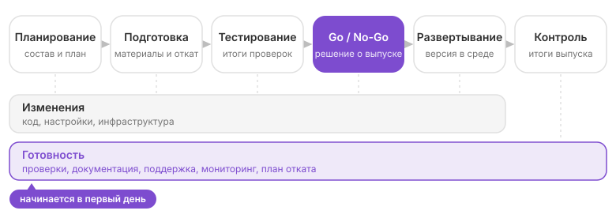
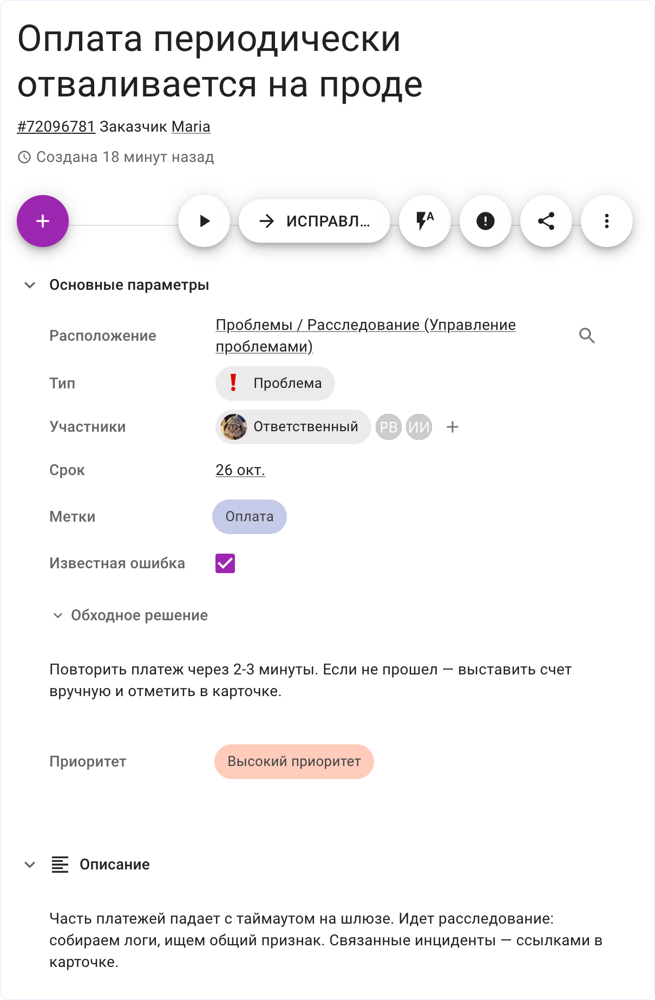
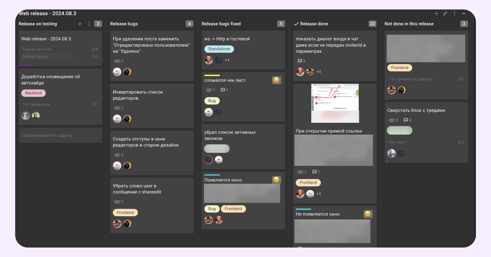
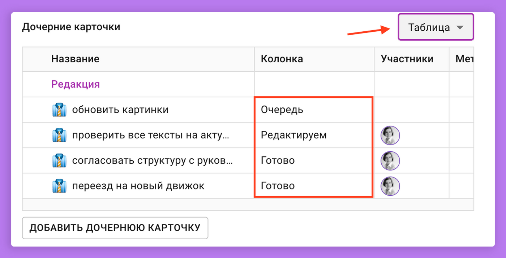
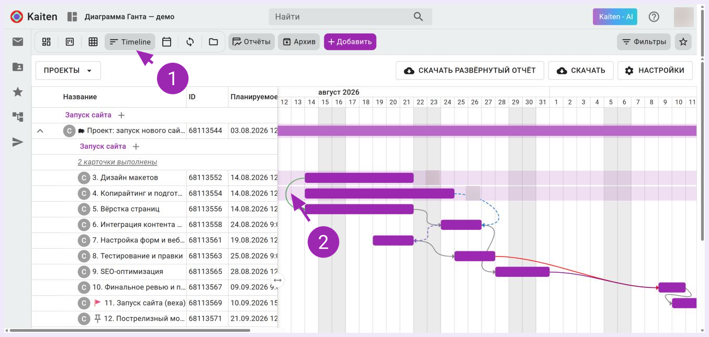
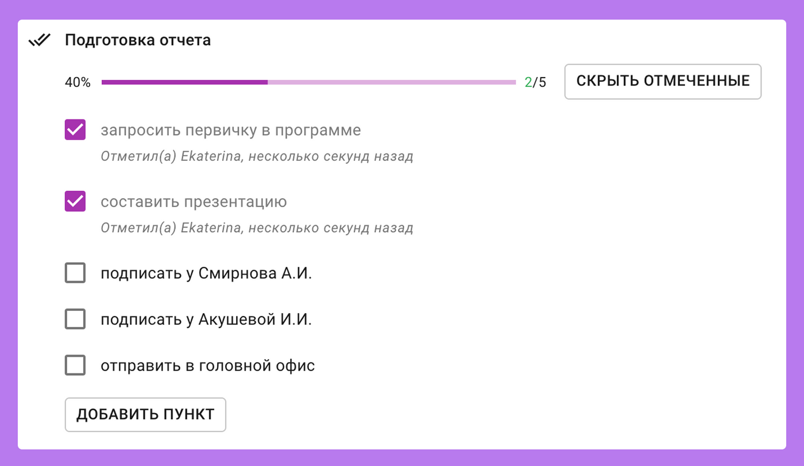

# Release Management: как организовать управление релизами в IT

В четверг вечером команда B2B-сервиса выпустила версию 2.8 с новой отчетностью, и до утра релиз считался удачным. Утром в поддержку написал клиент, у которого отчет не строился. Специалист не знал, что ответить, потому что сам впервые прочитал о новой функции в этом письме. Причина нашлась быстро: у клиента стояли нестандартные настройки, а на таких отчетность никто не проверял.

Дело не только в коде: никто не отвечал за то, чтобы к выпуску сошлись проверки, документация и поддержка. *Управление релизами* (*Release Management*) как раз и помогает координировать выпуск обновлений, контролировать готовность и снижать риски при развертывании. Дальше та же версия 2.8 пройдет путь заново — на этот раз с подготовкой.

## Что такое релиз в ИТ и программировании

*Релиз в ИТ* — это набор изменений, который становится доступен пользователям как одно целое. *Релиз в программировании* — и сам выпуск, и готовая версия продукта. Это может быть:

- новая функциональность;
- обновление существующего сервиса;
- пакет исправлений;
- изменение компонентов инфраструктуры;
- новая версия продукта.

Версия 2.8 — это новая функция и миграция данных под нее.

## Что такое Release Management и какие задачи он решает

*Release Management* — практика, которая отвечает за выпуск новых и измененных возможностей ИТ-сервисов. В ITIL 4, [своде практик управления ИТ-услугами](https://kaiten.ru/blog/itsm-i-itil-v-chem-raznica-metodologij/), ее [назначение](https://www.peoplecert.org/browse-certifications/it-governance-and-service-management/ITIL-1/itil-4-practitioner-release-management-3798) — делать новые и измененные услуги и функции доступными для использования. В ITIL (Version 5), вышедшей в 2026 году, набор практик в основном прежний.

Управление релизами отвечает на три вопроса: что выпускаем (состав релиза), когда и с кем (сроки, участники, коммуникации) и готовы ли (контроль готовности, управляемый выпуск, оценка результата).

## Чем релиз отличается от изменения и развертывания

Рядом с релизом стоят четыре понятия, которые часто путают: три [практики ITIL](https://kaiten.ru/blog/upravlenie-po-itil-4/) и автоматизация доставки.

| Понятие | Что означает |
|---|---|
| Change Enablement (обеспечение изменений) | Оценка рисков и авторизация изменений |
| Release Management | Планирование и координация предоставления изменений пользователям |
| Deployment Management | Техническое развертывание компонентов в целевой среде |
| CI/CD | Практики и инструменты автоматизации сборки, проверки и доставки изменений |

В версии 2.8 изменение — новая отчетность и технические решения под нее. Релиз — выпуск с проверками, документацией и обучением поддержки. Развертывание — размещение компонентов в рабочей среде (production).

Развернуть не значит выпустить: код может лежать в рабочей среде под переключателем функции, а клиентам его откроют позже. Конвейер CI/CD автоматизирует сборку, проверку и доставку, но состав и готовность релиза определяют люди.

## Виды релизов и релизная политика

Крупный релиз заметно меняет продукт, минорный добавляет небольшие улучшения, исправление (patch или hotfix) устраняет дефект, иногда вне графика. Названия и нумерация зависят от принятой в компании схемы версионирования.

Если любой выпуск проходит один круг проверок, исправление в одну строку ждет тех же подтверждений, что и крупное обновление. Чек-лист закрывают не глядя, срочные правки идут в обход правил. Поэтому глубину процесса задает тип релиза. Крупный идет по полному пути, а у срочного исправления проверки [сокращают и ускоряют](https://learn.microsoft.com/en-us/azure/well-architected/operational-excellence/safe-deployments), часть выполняют сразу после выпуска. Команда заранее записывает, кто вправе разрешить короткий маршрут и при каких условиях.

*Релизная политика* собирает такие правила в документ на страницу. В ней четыре темы, и каждая заранее снимает свой спор:

- ритм и состав: периодичность, формирование и изменение состава, заморозка — можно ли добавить задачу за день до выпуска;
- готовность: критерии, обязательные проверки, согласующие — что считать готовым и кто это подтверждает;
- выпуск: допустимые окна и порядок экстренных исправлений — когда выкладывать и что делать со срочным;
- страховка и коммуникации: правила отката и уведомления пользователей — когда возвращаться к прежней версии и кого предупреждать.

Ритм выбирают по-разному. При релизах по расписанию поддержка и клиенты знают дату, но готовое изменение ее ждет. При выпуске по мере готовности изменения быстрее доходят до пользователей, но нужны автоматические проверки и четкие критерии. Выбор зависит от продукта и цены ошибки.

## Этапы управления релизами

У релиза две линии работы: изменения и готовность. Вторая начинается в первый же день. Вот как версия 2.8 проходит шесть этапов, когда команда готовит выпуск заранее.

*Шесть этапов релиза и две линии работы: изменения и готовность*

### Планирование релиза

В плане команда записывает, что и когда выпускает: цель, состав изменений, затронутые сервисы, [зависимости](https://kaiten.ru/blog/zavisimosti-v-rabochiem-protsiessie/), сроки, ответственных, риски и ожидаемый результат. Состав релиза (release scope) собирают из задач и [пользовательских историй](https://kaiten.ru/blog/user-story-map-v-kaiten-ot-idei-do-reliza/) и фиксируют заранее. После даты заморозки задача попадает в состав только с переоценкой рисков — иначе тестировщики проверят одну сборку, а выйдет другая. В плане версии 2.8 техлид указывает порядок работ (миграция, API, интерфейс) и риск: нестандартные настройки клиентов.

**Результат:** согласованный план релиза.

### Подготовка изменений

Пока разработчики пишут код и готовят инфраструктуру, остальные участники составляют инструкции, описание изменений (release notes), документацию, материалы для поддержки, план коммуникаций и сценарий отката. Если отложить это до конца разработки, выпуск сдвинется или выйдет без материалов. Для версии 2.8 сценарий описывает и восстановление данных: вернуть прежний код недостаточно.

**Результат:** готовые изменения, материалы и сценарий отката.

### Тестирование и проверка готовности

Глубина проверок зависит от того, что может сломаться. Команда выбирает нужное: функциональные, регрессионные и интеграционные тесты, проверку совместимости, миграций и критичных сценариев. DevOps-инженер заранее настраивает мониторинг. QA-лид проверяет миграцию версии 2.8 на копии данных с нестандартными настройками — этой проверки не хватило в первый раз.

**Результат:** итоги проверок.

### Решение о выпуске: Go / No-Go

Перед выпуском команда отвечает на вопросы:

- завершены ли обязательные задачи;
- есть ли блокирующие дефекты;
- пройдены ли критичные тесты;
- готова ли эксплуатация;
- согласовано ли время выпуска;
- определен ли план восстановления;
- готовы ли поддержка и коммуникации.

Решение принимает заранее назначенный владелец релиза: Go — выпускаем, No-Go — нет.

**Результат:** записанное решение — Go или No-Go.

> **Важно.** No-Go — рабочий исход, а не провал: задачи возвращаются в работу, срок пересматривают.

### Развертывание

Версию ставят на все серверы сразу или по частям, открывают сначала малой доле пользователей (canary), переключают трафик между двумя средами (blue-green) или включают функцию переключателем (feature flags). Это стратегии развертывания и управления доступностью функции, а не виды управления релизами.

**Результат:** новая версия в рабочей среде.

### Контроль после релиза

Развернутая версия — еще не завершенный релиз. После выкладки команда проверяет ключевые сценарии пользователей, следит за ошибками и состоянием сервисов, смотрит бизнес-метрики, если релиз на них влияет, и обрабатывает обращения. После выхода 2.8 дежурный инженер проверяет отчеты у клиентов с нестандартными настройками. Сбой передают в [управление инцидентами](https://kaiten.ru/blog/incident-management/), а если быстро исправить не удается, версию откатывают.

**Результат:** проверенная версия и итоги для разбора.

## Кто отвечает за подготовку и выпуск

За выпуск отвечают двое: release-менеджер ведет план и следит за сроками, а владелец релиза принимает решение. В небольшой команде обе роли берет один человек — тимлид или менеджер продукта.

Остальные участники подтверждают свою часть и не ждут друг друга, поэтому согласование по кругу не нужно. Чтобы владелец не собирал подтверждения по личным сообщениям, команде нужно место, где их видят все.

## Практический пример: управление релизами в Kaiten

Участникам важно видеть состав релиза, состояние связанных работ, чек-лист и решение. Команда релиза 2.8 собирает их в Кайтене — системе управления рабочими процессами.

### Шаг 1. Создаем карточку релиза

Команда создает карточку «Релиз 2.8 — новая отчетность». Для релизов у нее свой тип карточки с шаблоном описания: цель, состав изменений, затронутые сервисы, план отката. Плановую дату команда ставит в поле «Срок», владельца назначает ответственным. План отката можно вынести в связанный [документ](https://kaiten.ru/features/documents/), сервисы — в пользовательское поле, если оно настроено. Цель, дата и владелец лежат в одной карточке.

*Пример: карточка задачи с типом, ответственным, сроком и своими полями — из статьи об управлении проблемами*

### Шаг 2. Собираем доску релизного процесса

На [канбан-доске](https://kaiten.ru/features/kanban/) карточка проходит колонки: Запланировано → Разработка → Тестирование → Подготовка к релизу → Готово к выпуску → Выпущено → Проверка после релиза → Завершено. Остановившуюся карточку блокируют и пишут причину — пометка видна на доске. Колонки — пример, а не стандартные статусы Кайтена: команда называет их сама. Так поступила и [команда Verbosity](https://kaiten.ru/blog/iz-chata-v-miessiendzhierie-v-kaiten/): ведет веб-релизы на отдельной доске, а общую карточку релиза с чек-листами создает своим скриптом через открытый API.

*Пример: доска веб-релизов команды Verbosity. Колонки у команды свои — их набор каждая команда задает сама*

### Шаг 3. Связываем релиз с задачами

К карточке команда добавляет дочерние: API, интерфейс, миграция данных, тестирование, документация, release notes, обучение поддержки, проверка мониторинга. У каждой есть ответственный и срок. Владелец видит в родительской карточке, в какой колонке каждая задача. Сроки показывает Timeline — вид с временной шкалой, а зависимости — [диаграмма Ганта](https://kaiten.ru/features/gant/).

*Пример: дочерние карточки в родительской — видно, в какой колонке каждая задача*

*Пример: связи между задачами на диаграмме Ганта — из Базы знаний Kaiten*

### Шаг 4. Добавляем чек-лист готовности

В чек-листе карточки четыре блока — по тому, кто закрывает пункты:

- разработка — обязательные изменения завершены, критичные дефекты устранены;
- тестирование — нужные проверки пройдены, результаты записаны;
- эксплуатация — окно развертывания согласовано, мониторинг подготовлен, сценарий отката проверен;
- коммуникации — документация обновлена, поддержка предупреждена, сообщения пользователям готовы.

У пунктов есть ответственные и сроки, а линия прогресса показывает, сколько осталось.

*Пример: чек-лист в карточке с отметками о выполнении — из Базы знаний Kaiten*

### Шаг 5. Фиксируем решение Go / No-Go

Владелец собирает подтверждения и записывает решение комментарием в карточке. Ее история хранит, кто и когда перенес карточку в «Готово к выпуску». При No-Go владелец возвращает задачи в работу и пишет, чего не хватило. Команда может закрепить правило ограничением в Кайтене: пока чек-лист не закрыт, карточку в эту колонку не перенести. Решение принимает человек — Кайтен не выносит его и не оформляет согласование юридически.

### Шаг 6. Контролируем результат

После выкладки команда отмечает в карточке фактическое время, результаты проверок, найденные проблемы и то, был ли откат. Из проблем она создает задачи на исправление или улучшение процесса и связывает их с этой карточкой.

> **Важно.** Кайтен помогает организовать работу участников, но не заменяет средства сборки, развертывания и мониторинга. Интеграции с GitLab и GitHub добавляют в карточку ссылки на коммиты и переносят ее по событиям в репозитории — после настройки вебхука. Не все доступно на любом тарифе: связи карточек, ограничения и интеграции — с тарифа «Стандарт», диаграмма Ганта — отдельный модуль.

[Организуйте планирование и подготовку релизов в Kaiten](https://kaiten.ru/)

## Чек-лист готовности к релизу

Пройдите по чек-листу перед решением о выпуске и после выкладки.

| Этап | Что проверить | Ответственная роль |
|---|---|---|
| Планирование | Состав релиза и срок согласованы | Release-менеджер |
| Разработка | Обязательные изменения готовы | Техлид |
| Качество | Критичные проверки пройдены | QA-лид |
| Эксплуатация | Мониторинг и откат подготовлены | DevOps-инженер или SRE |
| Коммуникации | Документация и поддержка готовы | Менеджер продукта и поддержка |
| Решение | Зафиксировано Go / No-Go | Владелец релиза |
| Пострелиз | Проверки завершены, итоги зафиксированы | Release-менеджер |

Роли примерные: в компании их могут распределить иначе. Чек-лист снижает риск пропустить подготовку, но не гарантирует отсутствие инцидентов.

## Метрики эффективности процесса

Качество *Release Management* видно по шести метрикам:

- соблюдение графика — доля релизов, вышедших в срок;
- доля изменений с отказом (change failure rate; в [исследованиях DORA](https://dora.dev/guides/dora-metrics/) теперь change fail rate) — доля развертываний, после которых понадобилось немедленное вмешательство;
- откаты — количество и причины возвратов к предыдущей версии;
- пострелизные дефекты — ошибки, найденные после выкладки;
- время восстановления — сколько занимает возврат к нормальной работе после неудачного развертывания;
- выполнение критериев готовности — доля релизов с полностью закрытым чек-листом.

Они нужны, чтобы разбирать процесс, а не наращивать число релизов.

## Типичные ошибки

Пять сбоев процесса и то, что их предотвращает:

- **задачи добавляют перед самым выпуском** — и риск никто не пересчитывает. Помогает дата заморозки в *релизной политике*: после нее состав меняет только владелец;
- **у релиза нет владельца** — решение принимает тот, кто оказался в чате. Владельца и замещающего назначают при планировании;
- **сценарий отката не проверяли** — о том, что данные не вернуть, команда узнает во время сбоя. Сценарий прогоняют до выпуска;
- **о документации и поддержке вспоминают после выпуска** — материалы для поддержки ставят в план отдельными задачами с первого дня;
- **инциденты после релиза не разбирают** — команда проводит короткий разбор и записывает выводы, а причины повторяющихся сбоев ищет [управление проблемами](https://kaiten.ru/blog/problem-management/).

Каждое правило — строка в политике или задача в плане.

## Что стоит запомнить

Во второй раз код версии 2.8 был тем же, но команда заранее знала о нестандартных настройках и подготовила поддержку. Предсказуемость держится на трех опорах: у решения есть владелец, критерии записаны, готовность видна в одном месте. От лишних согласований защищает правило: глубина проверок зависит от риска. Выстраивать *управление релизами* начинают с малого: с критериев готовности и карточки ближайшего выпуска.

## Служебное: самопроверка исправленного черновика (не публикуется)

> Исправленный черновик по `07_revision_task.md` (вычитка `05`, оценка `06` — 82/100, HARD-замечаний
> нет). Решение редактора от 2026-11-24: потолок объема 13 400 знаков, вносим все правки.

- **После повторной оценки (`09_rescore.md`, 93/100):** внесены обе обязательные правки (Н1 — этапы названы прямо в точке переключения; Н2 — правило закрепляет команда ограничением в Кайтене) и мелкие Н3–Н11: результат этапа Go / No-Go, «команда релиза 2.8», фраза о новой версии ITIL, «сразу после выпуска», единое оформление списка ошибок, другое последствие в первой ошибке, пометка о версии 2.8 в «Контроле», подводки в блоке политики, подлежащее в оговорке о колонках. Стык в лиде смягчен: «Дело не только в коде».
- **Объем:** 13 399 знаков с пробелами вместе с заголовками и таблицами (текст 12 625 + заголовки 774) при потолке 13 400. Подписи к картинкам в объем не входят.
- **Обязательные правки — внесены все девять:** рамка сквозного примера названа в лиде («та же версия 2.8 пройдет путь заново») и во вводном абзаце «Этапов»; подводка к таблице понятий — «четыре понятия, которые часто путают»; задачи практики привязаны к трем вопросам; у каждой темы политики назван спор, абзац о двух подходах начинается от темы «ритм»; результат этапа вынесен отдельной строкой; формулировки о Кайтене уточнены (интеграции — ссылки на коммиты и перенос карточки по событиям; чек-лист — блоки пунктов; «помогает организовать»; при первом упоминании — «система управления рабочими процессами»); повтор о подтверждениях убран из Go / No-Go, в ошибках 1–3 показано последствие; «выпуск» — 27 вхождений вместо 48, «релиз» — 53 вместо 56, вместе 5,1% слов вместо 6,0%; про ITIL (Version 5) сказано только подтвержденное, оговорка о тарифах начинается со слов «не все доступно на любом тарифе».
- **Желательные правки — внесены:** лид начинается со сцены, без зачина «Бывает так», фраза из ТЗ начинается с ключа; раздел ролей — две роли одной фразой и различие «подтверждают свою часть и не ждут друг друга»; во вставках о версии 2.8 действуют техлид, QA-лид, DevOps-инженер и дежурный инженер; мониторинг, отложенная подготовка и Timeline объяснены; у пятой метрики есть определение; карточка названа — «Релиз 2.8 — новая отчетность»; порядок фраз в шаге 2 исправлен; четыре лишних противопоставления и три счетных анонса сняты; канцелярит из ТЗ заменен.
- **Не вошло из-за объема:** фраза «что это дает владельцу» в шагах 2 и 6; пункт о нестандартных настройках в чек-листе шага 4 (риск показан в «Тестировании» и «Контроле»); русское пояснение у Deployment Management в таблице; пример зависимости в шаге 3.
- **Два факта:** тариф для типов карточек ни на странице тарифов, ни в справке не указан — в тексте тип карточки подан как настройка команды, оговорка о тарифах не утверждает, что остальное доступно всем. Перечень практик ITIL (Version 5) по первоисточнику не сверялся — в тексте только то, что подтверждает правообладатель: набор практик в основном прежний.
- **Картинки вставлены** вместо пометок: схема `assets/release-path.svg` и пять готовых скриншотов из `assets/images/` с подписями «Пример: …» и alt. Иллюстрация Ганта с рекламными выносками заменена скриншотом из Базы знаний (август 2026). Обложка — `assets/cover.svg`, ставится отдельно.
- **Механика:** `tools/vale_lite.pl` — 0 ошибок, 0 предупреждений; буква «ё» — 0; средняя длина предложения 11,1 слова; длиннее 20 слов — 9, перечисления и оговорки.
- **Ключи и ссылки:** ключи 5 из 5; 10 внутренних ссылок + CTA и 3 внешние — без изменений.
- **Уникальность (локально, цепочки по 4 слова):** 0,1–0,3% с пятью ближайшими текстами; единственный кусок от 6 слов — подзаголовок из ТЗ.
- **Не сделано (за редактором):** «Тургенев», text.ru, «Главред», «Орфограммка».
